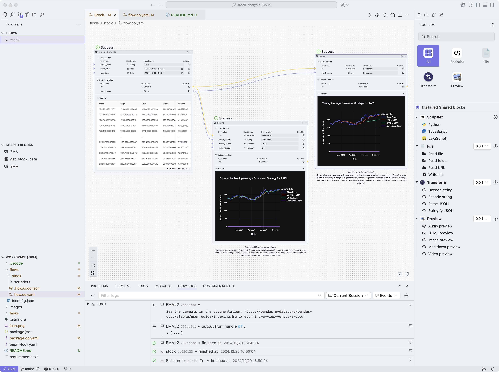

# Project Overview

This project is a stock data analysis workflow. The workflow consists of three nodes: getting stock data, calculating Simple Moving Average (SMA), and calculating Exponential Moving Average (EMA).

## Node Descriptions
### 1. Get Stock Data
* Node ID: `get_stock_data#1`
* Input Parameters:
	+ `stock_name`: Stock name (default: `AAPL`)
	+ `start_time`: Start time (default: `2023-10-05T14:25:21+08:00`)
	+ `end_time`: End time (default: `2024-10-31T14:25:21+08:00`)
* Output Parameters:
	+ `df`: Stock data
	+ `stock_name`: Stock name

### 2. Simple Moving Average (SMA)
* Node ID: `SMA#1`
* Input Parameters:
	+ `df`: Stock data (from `get_stock_data#1` node)
	+ `stock_name`: Stock name (from `get_stock_data#1` node)
* Description:
The Simple Moving Average (SMA) is the average of stock prices over a certain period of time. When the price is above its moving average, it is generally considered an uptrend; when the price is below its moving average, it is a downtrend. Traders can generate buy or sell signals based on price crossing a moving average.

### 3. Exponential Moving Average (EMA)
* Node ID: `EMA#2`
* Input Parameters:
	+ `short_window`: Short window (default: `30.03`)
	+ `long_window`: Long window (default: `24`)
	+ `df`: Stock data (from `get_stock_data#1` node)
	+ `stock_name`: Stock name (from `get_stock_data#1` node)
* Description:
The Exponential Moving Average (EMA) is also a moving average, but it gives more weight to recent data, making it more responsive to the latest price changes. EMA is similar to SMA, but puts more emphasis on recent prices and is therefore more sensitive in terms of trend identification.